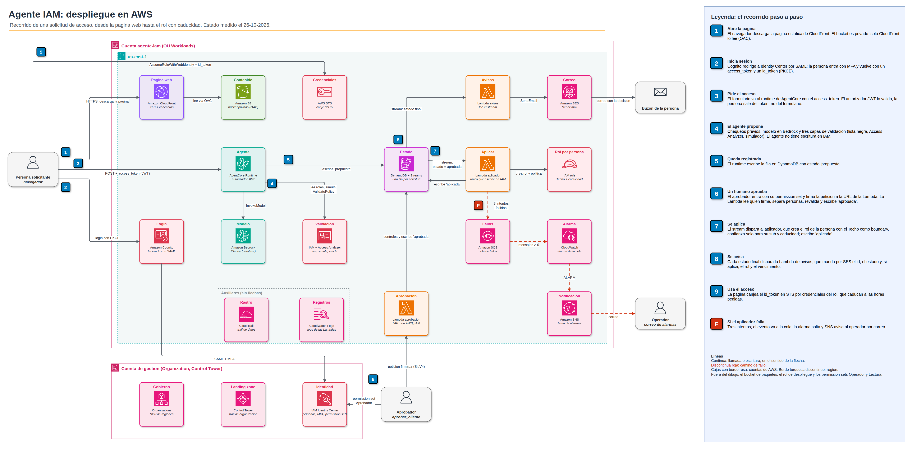

# Agente IAM

Agente que traduce una solicitud de acceso estructurada en una propuesta de
politica IAM de minimo privilegio, la valida en codigo y con los servicios
de AWS, y la deja lista para que un humano la apruebe. Un proceso aparte,
con su propio rol, aplica solo lo aprobado. El agente **no aplica cambios**.

Actualizado: 26-10-2026. El historial de cambios es `git log`.

## Como funciona

Una solicitud entra como JSON; un agente (Strands sobre Bedrock) con un rol de
solo lectura propone la politica; el codigo la valida con lista negra, el
catalogo oficial de acciones, Access Analyzer y el simulador de IAM; un humano
aprueba una huella exacta del registro; y un aplicador distinto, el unico con
escritura en IAM, la adjunta al destinatario. La justificacion de la solicitud
es texto no confiable y nunca decide nada.

Hay dos modos, y en produccion solo uno. El **servidor** (AgentCore Runtime) acepta un unico contrato (`SolicitudWeb`): el
beneficiario sale del token de la persona, no del formulario, y el permiso se materializa en un rol creado para ella, con
el techo como boundary y una vida de 1 a 12 horas (Fase 23, bloque 1: desplegado y medido de punta a punta el 26-10-2026, `docs/MEDICIONES.md` O.2 y O.3). El **CLI de desarrollo**
(`agente_iam.cli`, sobre disco, sin token) conserva el modo anterior: adjuntar la politica a un principal que ya existe y
lleva el techo. Decision y limites: `docs/ADR-004-rol-por-persona-y-confianza-por-token.md`.

## Principio de diseno

El LLM interpreta la intencion. No es la autoridad sobre los permisos.

```
solicitud JSON (la justificacion es dato NO confiable)
  -> solicitar.py enviar: POST al runtime de AgentCore con el JWT de Cognito (Identity Center);
     el autorizador valida el token y el servidor graba quien pidio
  -> contrato Pydantic: alfabetos cerrados         rechaza la forma invalida
  -> chequeos previos: servicio permitido, principal real,
     boundary AgenteIAM-Techo puesto, EC2 solo lectura,
     recurso que no es del propio sistema           rechaza sin invocar al modelo
  -> agente Strands + Bedrock (rol de SOLO lectura) propone
  -> validacion desde el codigo:
       lista negra + catalogo oficial, Access Analyzer, simulador de IAM
       (bajo el boundary del beneficiario) y coherencia con el formulario
       (destinatario, servicio, nivel de acceso, recurso, EC2 solo
       Describe* y nada sobre los recursos del propio sistema)
  -> loop de reparacion, maximo 3 vueltas contadas en Python
  -> registro con estado (disco o DynamoDB)        se escribe SIEMPRE
  -> aprobar_cliente: la persona ve la propuesta y su huella, y manda la peticion
     firmada; la Lambda agente-iam-aprobacion identifica quien firma, corre los
     controles y escribe la decision
  -> aplicador: Lambda agente-iam-aplicador, disparada por el stream de la tabla con estado = aprobada
     (rol propio, unico con escritura en IAM, no habla con el modelo); escribe `aplicada` o
     `bloqueada_al_aplicar`
```

Tres decisiones que sostienen todo:

1. Quien interpreta texto no confiable nunca tiene escritura en IAM. Una
   inyeccion de prompt, en el peor caso, produce una propuesta mala que un
   humano rechaza.
2. La validacion es determinista. El codigo y los servicios de AWS tienen
   la ultima palabra, no el modelo.
3. Se revalida fuera del agente, al aprobar y otra vez al aplicar.

## Estado

El circuito completo se ejecuto contra una cuenta AWS real el 30-08-2026. Desde el
25-10-2026 estan desplegadas las pilas de CloudFormation de gobierno de regiones,
identidades, arranque (con el techo v3), base (tabla de DynamoDB y Lambda de
aprobacion), acceso (Cognito federado con Identity Center), runtime (AgentCore con
JWT, Lambda del aplicador, cola de fallos, alarma y trail de datos) y beneficiarios
(rol y bucket de demo) (`docs/DESPLIEGUE.md`). El circuito completo de esa cuenta esta
medido de punta a punta el 25-10-2026: solicitud con JWT al runtime, aprobacion por la
Lambda con una segunda persona y aplicacion automatica por el aplicador cinco segundos
despues; tambien el trail de datos y el camino de fallo (cola, alarma y correo)
(`docs/MEDICIONES.md` L y M). Estado detallado, limitaciones y proximos pasos:
`CONTEXTO.md` §2, §5, §10 y §11.

Los tres bloques de la Fase 23 estan **desplegados y medidos el 26-10-2026** (`docs/MEDICIONES.md` O.2 a O.5). El bloque 1
(rol por persona con caducidad, canje del token con `AssumeRoleWithWebIdentity`) se desplego en O.1 y se midio de punta a punta en
O.2 y O.3. El bloque 2 (pagina web tras CloudFront, con su cliente de Cognito) se midio en O.4. El bloque 3 (correo por SES con la
decision) se midio en O.5: los correos `rechazada_en_chequeos_previos`, `aprobada` y `aplicada` salieron. El vencimiento real de un rol de
persona se midio en O.6. TLS 1.2 con dominio propio se desplego y se midio el 27-10-2026 (Fase 27, `docs/MEDICIONES.md` P.5 a P.7 y Q.1), y el correo sale desde ese dia de un dominio propio verificado en SES (Fase 28, R.1 a R.5).

## Estructura

```
main.py                     entrypoint del paquete desplegado (AgentCore)
agente_iam/
  config.py                 region, modelo, barandas, techo, almacen, SOLO_LECTURA y prefijos del sistema
  models.py                 contratos Pydantic de entrada y salida (`SolicitudWeb` es el del servidor)
  personas.py               el rol por persona (Fase 23): nombre, ARN e id deterministas, vencimiento y confianza del rol
  avisos.py                 Lambda de avisos (Fase 23, bloque 3): un correo por SES cuando la solicitud acaba algo para la persona
  identidad.py              ARN canonico, id unico y boundary del principal
  existencia.py             que el recurso pedido existe en la cuenta, antes de llamar al modelo (Fase 28): existe, no_existe, no_comprobado o no_aplica
  motivos.py                el motivo corto de cada estado ({codigo, texto}, frases fijas) para la pagina y el correo (Fase 28)
  agente.py                 BedrockModel + tools + system prompt
  orquestador.py            chequeos previos, loop de reparacion, delta
  coherencia.py             propuesta vs formulario (chequeos posteriores) y riesgo minimo fijado por el codigo
  simulacion.py             eficacia y redundancia con el simulador de IAM
  huella.py                 hash canonico del registro aprobado
  almacen.py                registro en disco o en DynamoDB; en DynamoDB un atributo por actor
                            (documento, estado, aprobacion, rechazo, aplicacion) y solo UpdateItem
  aprobar.py                el servidor de la aprobacion: los controles y la Lambda `agente-iam-aprobacion`; el rechazo es el bloque `rechazo`
  aprobar_cliente.py        la persona: lee, ensena la huella y manda la peticion firmada a la Lambda (comando aparte)
  aplicador.py              aplica lo aprobado (comando aparte); escribe el bloque `aplicacion`
  cli.py                    intake por linea de comandos (solo el modo de principal existente)
  servidor.py               el intake como servicio HTTP de AgentCore: un solo contrato, el beneficiario sale del token y la respuesta lleva una vista reducida del registro
  herramientas/
    validacion.py           tool: lista negra + Access Analyzer
    catalogo.py             tool: catalogo oficial de acciones y niveles
infra/                      lo que se despliega: politicas JSON de los roles, el techo (lo
                            lee aprobar.py) y la clave KMS; sin guias
  cfn/                      plantillas de CloudFormation (gobierno de regiones, identidades, base, arranque, acceso,
                            web, runtime, beneficiarios, prueba eco)
  pruebas-agentcore/        agente eco y su rol, para las pruebas de AgentCore
web/                        la pagina web (Fase 23, bloque 2): `index.html`, `estilos.css`, `app.js` y `vista-previa.png` (vista previa en LinkedIn, Fase 29), sin dependencias ni nada de la cuenta
docs/                       guias, ADR, especificacion y mediciones; `docs/arquitectura/` lleva los diagramas (draw.io, PNG y SVG, en espanol y en ingles) y la animacion del recorrido
portafolio/                 lo que se publica fuera (LinkedIn y la pagina personal): copias exportadas, la fuente sigue en docs/arquitectura/; tambien el video de demostracion (`docs/VIDEO-DEMO.md`)
ejemplos/                   solicitudes de prueba, incluidas las adversarias; `ejemplos/web/` lleva el contrato del servidor
tests/
  unitarios/                sin red ni credenciales; en cada commit (el rol por persona: `test_personas.py` y
                            `test_rol_por_persona.py`)
  seguridad/                barandas, techo, listas de bloqueo, secretos; en cada commit (`test_modos.py`: un modo en
                            produccion, dos en el repositorio)
  funcionales/              contra la cuenta real; solo si se pide (incluido el que compara el techo con la referencia de hoy)
scripts/localizar.py        copias de ejemplos/ e infra/ con tu cuenta, en local/
scripts/pruebas.sh          corre un tipo de tests y guarda su evidencia en evidencias/
scripts/empaquetar.sh       construye dist/agente-iam.zip para AgentCore y, con `aprobacion` o `aplicador`, el zip de la Lambda de aprobacion o del aplicador (`requirements-aplicador.txt`)
scripts/solicitar.py        el cliente del solicitante: `token` (login con Identity Center), `enviar` (POST al runtime con el JWT) y `asumir` (canjea el `id_token` por las credenciales del rol de la persona)
scripts/construir_web.py    escribe en local/web/ la pagina con su config.js (listas de config.py y salidas de las pilas acceso y runtime)
scripts/construir_arquitectura.py traduce al ingles, exporta a PNG y SVG los diagramas de docs/arquitectura/ con draw.io de escritorio y construye la animacion del recorrido (Fases 24 y 25); `--sin-exportar` no necesita draw.io
scripts/comparar_modelos.py compara dos modelos de Bedrock con los casos de ejemplos/ (cuesta dinero)
scripts/generar_techo.py    genera el techo de los beneficiarios (infra/boundary-agente-iam-techo.json y su copia en arranque.yaml) desde config.py y la referencia de autorizacion; --comprobar no escribe
scripts/matriz_regiones.py  comprueba contra la cuenta la SCP de Bedrock y la denegacion de regiones
scripts/prueba_b.py         pasos de la Prueba B que necesitan un humano: token, invocaciones y CloudTrail
scripts/sonda_cuenta.py     mide con llamadas reales si llega aws:ResourceAccount y que haria el Deny S5 del techo
scripts/sonda_atributos.py  mide con llamadas reales que dynamodb:Attributes frena lo que no es del aprobador; con --solo-lectura, que el aprobador no escribe nada (ADR-003)
.github/workflows/          CI: unitarios y seguridad en cada push
```

El repositorio usa `111122223333`, la cuenta de ejemplo de la documentacion
de AWS, en `infra/`, `ejemplos/`, tests y documentos. Para usarlos contra tu
cuenta, genera las copias locales (la carpeta `local/` no se versiona):

```bash
./.venv/bin/python scripts/localizar.py
```

## Requisitos

- Python 3.12
- Credenciales AWS por Identity Center, sin clave de acceso (perfiles SSO; los
  perfiles `agente-iam` y `agente-iam-aplicador` ya no existen desde el
  25-10-2026). El intake de la cuenta no usa perfil: `scripts/solicitar.py` manda
  un JWT al runtime. Ver `CONTEXTO.md` §5 y §12.
- Modelos de Anthropic habilitados en Bedrock.
- El beneficiario de cada solicitud debe llevar el permission boundary
  `AgenteIAM-Techo`. Es el requisito de alta del sistema (en el modo de rol por persona, el rol nace con el techo).

## Instalacion

```bash
python3 -m venv .venv
./.venv/bin/pip install -r requirements.txt -r requirements-dev.txt -c constraints.txt
```

## Uso

```bash
# 1. Intake: la persona saca su token (queda en local/tokens/, nunca se imprime) y lo manda al runtime
./.venv/bin/python scripts/solicitar.py token --usuario mateo
./.venv/bin/python scripts/solicitar.py enviar local/ejemplos/solicitud-finanzas-demo.json --usuario mateo
#    (agente_iam.cli es el intake local, con credenciales propias)
#    Rol por persona (Fase 23, bloque 1; medido de punta a punta el 26-10-2026, `docs/MEDICIONES.md` O.2 y O.3): el contrato del servidor no lleva ARN ni id; la
#    clave_envio la pone el script (con --clave se repite el mismo envio y el servidor devuelve el mismo id)
./.venv/bin/python scripts/solicitar.py enviar local/ejemplos/web/persona-finanzas-demo.json --usuario solicitante.demo [--clave UUID]
#    con la solicitud aplicada, la persona asume el rol que se creo para ella (rol_previsto) con su token
./.venv/bin/python scripts/solicitar.py asumir <rol_arn> --usuario solicitante.demo --horas 4 --listar finanzas-demo-<cuenta>

#    La pagina web (bloque 2, medida el 26-10-2026, `docs/MEDICIONES.md` O.4) pide lo mismo desde el navegador. Se construye aqui y la
#    sube el administrador al bucket agente-iam-web-<cuenta> con su Content-Type (`docs/DESPLIEGUE.md`); su URL es la salida UrlWeb
#    de la pila agente-iam-web
./.venv/bin/python scripts/construir_web.py --perfil org-agente-iam --destino local/web

# 2. Aprobacion, con credenciales de humano. La primera corrida muestra la
#    propuesta y su huella; la segunda aprueba exactamente esa huella.
./.venv/bin/python -m agente_iam.aprobar_cliente req-012-jose
./.venv/bin/python -m agente_iam.aprobar_cliente req-012-jose --huella sha256:...

#    O se rechaza, con motivo; queda como bloque `rechazo`, distinto de `aprobacion`
./.venv/bin/python -m agente_iam.aprobar_cliente req-012-jose --rechazar "motivo"

# 3. Aplicacion: automatica, por la Lambda agente-iam-aplicador (stream de la tabla).
#    El CLI solo existe para desarrollo, con ALMACEN=disco
ALMACEN=disco ./.venv/bin/python -m agente_iam.aplicador req-012-jose

# Techo de los beneficiarios (no se edita a mano; descarga la referencia de AWS, sin credenciales)
./.venv/bin/python scripts/generar_techo.py              # reescribe el JSON y la copia de arranque.yaml
./.venv/bin/python scripts/generar_techo.py --comprobar  # sale con 1 si difieren
```

Codigos de salida: `0` procesada o decidida, `1` error (tambien un control que no
pudo ejecutarse), `2` forma invalida (intake y `solicitar.py`), `3` bloqueada por
un control (aprobar_cliente y aplicador como CLI).

Con `ALMACEN=dynamodb`, cada actor escribe solo sus atributos de la fila de la
solicitud (`documento` el intake, `aprobacion` y `rechazo` la Lambda de aprobacion (ADR-003),
`aplicacion` el aplicador, `estado` los tres) y nadie usa `PutItem`, para que
IAM pueda separar "aprobar" de "reescribir la propuesta". Por defecto el
almacen es el disco.

Variables de entorno: `AWS_REGION`, `MODEL_ID`, `ALMACEN` (`disco` o
`dynamodb`), `DIR_SOLICITUDES`, `TABLA_SOLICITUDES`, `DIR_CACHE_CATALOGO`,
y `PERMITIR_ALMACEN_EFIMERO=si` para probar el servidor en local.
`AGENTE_IAM_URL_APROBACION` es la salida `UrlAprobacion` de la pila
`agente-iam-base`, a donde `aprobar_cliente` manda su peticion; con `ALMACEN=dynamodb` y sin ella
el comando no decide nada.
`AGENTE_IAM_PERMITIR_AUTOAPROBACION=si`, en el entorno del aplicador como CLI, es lo
unico que le deja aplicar una aprobacion con la separacion de funciones
saltada (`--autoaprobacion-demo`); la Lambda del aplicador no la lleva.
La Lambda del aplicador necesita `ALMACEN=dynamodb`, `TABLA_SOLICITUDES` y
`DIR_CACHE_CATALOGO`; para aplicar en modo rol por persona (Fase 23) necesita ademas `AGENTE_IAM_POOL_ID` (el id del user
pool de Cognito) y `AGENTE_IAM_CLIENTES` (los ids de sus clientes, separados por coma), que pone `runtime.yaml`: vacias,
el aplicador no aplica en ese modo. `AGENTE_IAM_REMITENTE` (bloque 3) es la direccion de SES desde la que manda
la Lambda `agente-iam-avisos`; es obligatoria en ella y la pone `runtime.yaml` desde `CorreoRemitente`. El aviso solo llega a
`correo_aviso` si esta verificado en SES (modo inicial).
Fase 28 (desplegada y medida el 27-10-2026): `AGENTE_IAM_COMPROBAR_EXISTENCIA` (por defecto activa; con `0` el
orquestador no busca el recurso en la cuenta, como en los tests sin red) y `AGENTE_IAM_URL_WEB` (la URL de la pagina, para el
enlace `?solicitud=<id>` del correo `aplicada`; la pone `runtime.yaml` desde `UrlWebAvisos`). El formulario ya no pide el tipo de
acceso: la solicitud va en un solo texto y el campo `recurso` admite el nombre o el ARN.

## Tests

Tres tipos, uno por carpeta de `tests/`. La carpeta decide el marcador de
pytest (`unitarios`, `seguridad`, `funcionales`), asi que tambien se
pueden elegir con `-m`.

```bash
scripts/pruebas.sh unitarios      # cada pieza con dobles, sin red, mas ruff y mypy
scripts/pruebas.sh seguridad      # los controles, mas bandit y pip-audit (necesita red)
scripts/pruebas.sh funcionales    # el sistema de verdad contra la cuenta
./.venv/bin/python -m pytest tests/ -q   # todo de una vez, sin evidencia
```

Cada `scripts/pruebas.sh` deja su evidencia en `evidencias/<tipo>/<fecha>/`,
fuera de git.

Los **funcionales** se saltan, y dicen por que, salvo con
`AGENTE_IAM_FUNCIONALES=si` (`AGENTE_IAM_FUNCIONALES=si scripts/pruebas.sh funcionales`,
con `AWS_PROFILE=org-agente-iam-lectura`, el unico perfil de la lista blanca de `tests/puerta.py` desde el
25-10-2026: solo lectura en `agente-iam`), sin claves en variables de entorno. Escriben en la
carpeta de evidencia, nunca en `solicitudes/`, y no corren en CI. Detalle en
`CONTEXTO.md` §7.

Unitarios y seguridad no necesitan credenciales.
`tests/unitarios/test_documentacion.py` falla si un modulo nuevo no aparece en
este README y en `CONTEXTO.md`, o si un test vive fuera de las tres carpetas;
`tests/seguridad/test_secretos.py` falla si algo versionable contiene una
credencial o la cuenta real. En GitHub, `.github/workflows/pruebas.yml` corre
unitarios y seguridad (con `gitleaks git` sobre todo el historial) en cada push
y pull request y sube la evidencia como artifact.

gitleaks, mas unitarios y seguridad, van en `.pre-commit-config.yaml`:

```bash
./.venv/bin/pip install pre-commit && ./.venv/bin/pre-commit install
```

## Documentacion



La arquitectura desplegada, dibujada con los pasos 1 a 9 y el camino de fallo F (Fase 24, 26-10-2026). La animacion del recorrido
es `docs/arquitectura/agente-iam-animacion.html`, un solo fichero que se abre con doble clic.
Hay version en ingles (Fase 25): `docs/arquitectura/agente-iam-despliegue-en.png` y `agente-iam-contexto-en.png`; la animacion tiene
boton ES/EN y `?lang=en` la abre en ingles.

| Archivo | Para que |
|---|---|
| `CONTEXTO.md` | Traspaso: arquitectura, decisiones, estado real, errores, limitaciones y proximos pasos |
| `PLAN-CORRECCIONES.md` | Las fases, una por avance, con su estado y su verificacion |
| `ESTUDIO-diseno-y-seguridad.md` | Principios y lecciones de diseno y seguridad, con un catalogo de casos (las de la Fase 23, en §23) |
| `docs/MEDICIONES.md` | Todo lo medido contra la cuenta y los servicios, con su fecha, lo que se creyo y resulto falso (§H) y lo no medido (§J) |
| `docs/DESPLIEGUE.md` | Guia de pilas: que se despliega en AgentCore Runtime, en que orden y que esta ya en la cuenta |
| `docs/CONTROL-TOWER-CHECKLIST.md` | Guia ya ejecutada: la landing zone con Control Tower, resumida (Fase 10, paso 1) |
| `docs/PRUEBAS-AGENTCORE.md` | Guia ya ejecutada: las dos pruebas de AgentCore con Identity Center (A no viable, B pasa), resumida |
| `docs/ADR-001-agentcore-identidad.md` | Decision: Cognito federado con Identity Center y JWT en AgentCore; la persona no llega al rol |
| `docs/ADR-002-techo-beneficiarios.md` | Decision: estrechar el techo de los beneficiarios (gestion de permisos, recursos del propio sistema, EC2 solo inventario) |
| `docs/ADR-004-rol-por-persona-y-confianza-por-token.md` | Decision: el permiso es un rol por persona con caducidad, que ella asume con su token de Cognito (Fase 23; los tres bloques desplegados y medidos el 26-10-2026, `docs/MEDICIONES.md` O.2 a O.5) |
| `docs/ADR-005-dominio-propio-y-tls.md` | Decision: la pagina web pasa a `agente-iam.mateo.solutions` con certificado de ACM para fijar TLS 1.2 (Fase 27; plantillas escritas el 26-10-2026, sin desplegar) |
| `docs/ESPECIFICACION-agentcore.md` | Lo que el bloque 3 debe construir para cumplir el ADR-001, medido o de diseno |
| `docs/arquitectura/GUIA-VISUAL.md` | La guia visual: los diagramas de contexto y de despliegue, la animacion del recorrido, como se hicieron y como se editan (Fase 24) |
| `portafolio/README.md` | La carpeta de las piezas que se publican fuera (LinkedIn y la pagina personal): que hay, sus reglas y lo pendiente (Fase 26) |
| `CLAUDE.md` | La regla de mantener todo esto al dia |

## Acceso a modelos en Bedrock

Si aparece `ResourceNotFoundException: Model use case details have not been
submitted for this account`, falta el formulario de caso de uso de Anthropic
en la consola de Bedrock. El modelo por defecto es
`us.anthropic.claude-haiku-4-5-20251001-v1:0`: la SCP de la cuenta
`agente-iam` solo admite perfiles `us.`. Se cambia con `MODEL_ID`. Comparacion
de modelos y cuotas: `docs/MEDICIONES.md` §C.

## Licencia e historia

MIT; ver `LICENSE`. Los iconos de AWS de los diagramas son de AWS y no los cubre
esta licencia (`docs/arquitectura/GUIA-VISUAL.md`).

Este repositorio publico nace de un solo commit. La historia anterior queda en
un repositorio privado: los hashes de commit que citan `PLAN-CORRECCIONES.md`,
`CONTEXTO.md` y `docs/` son de alli y no existen aqui.
